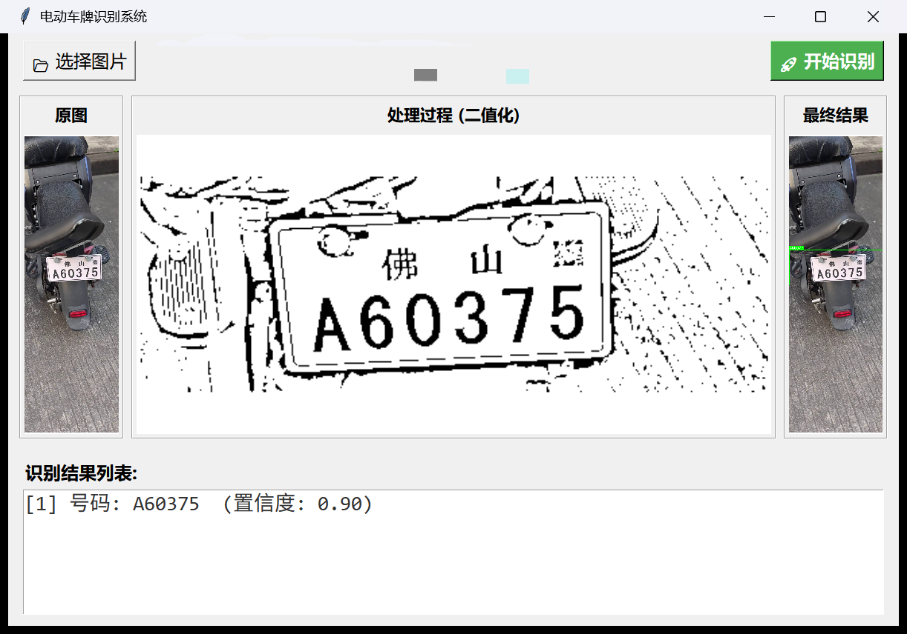
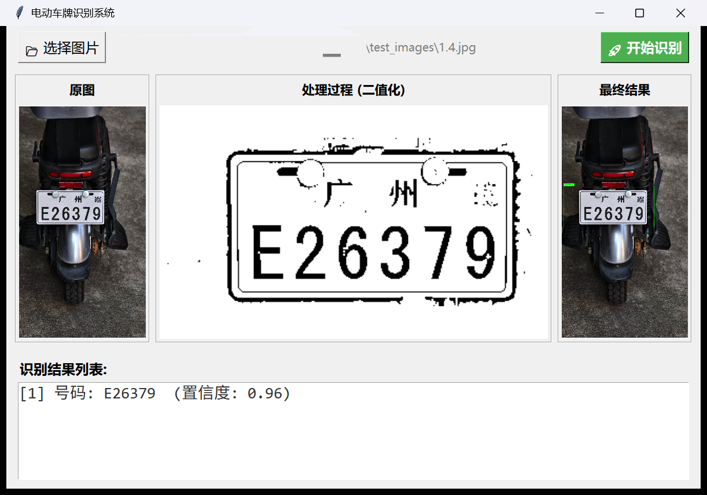
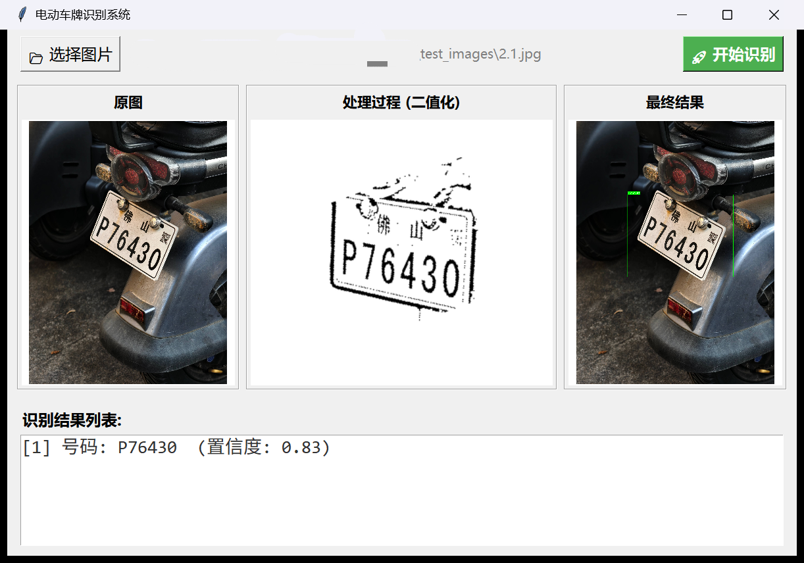
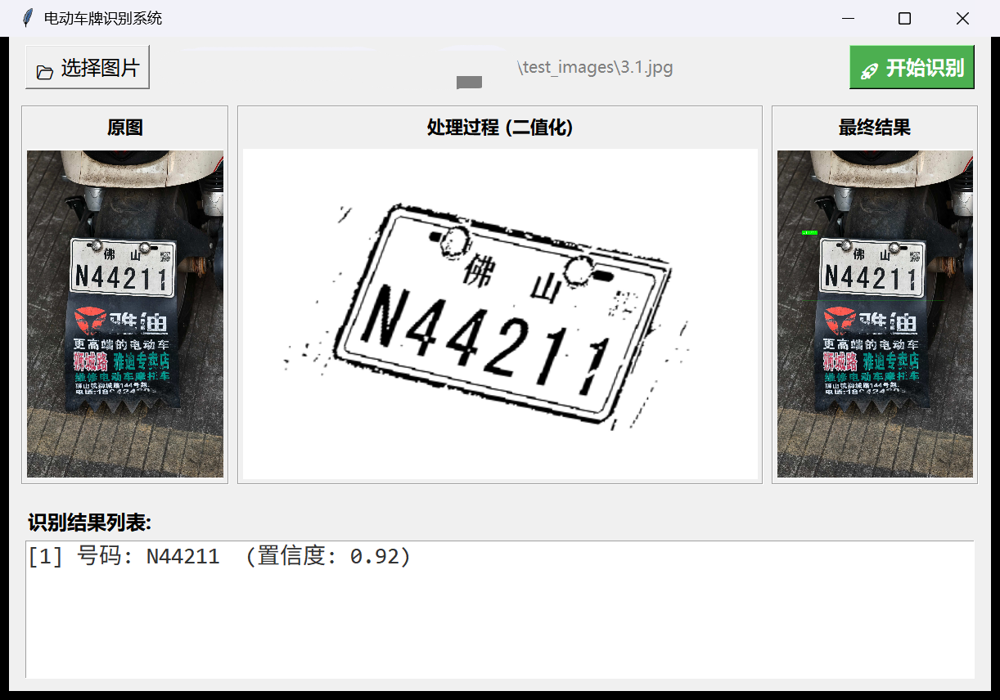
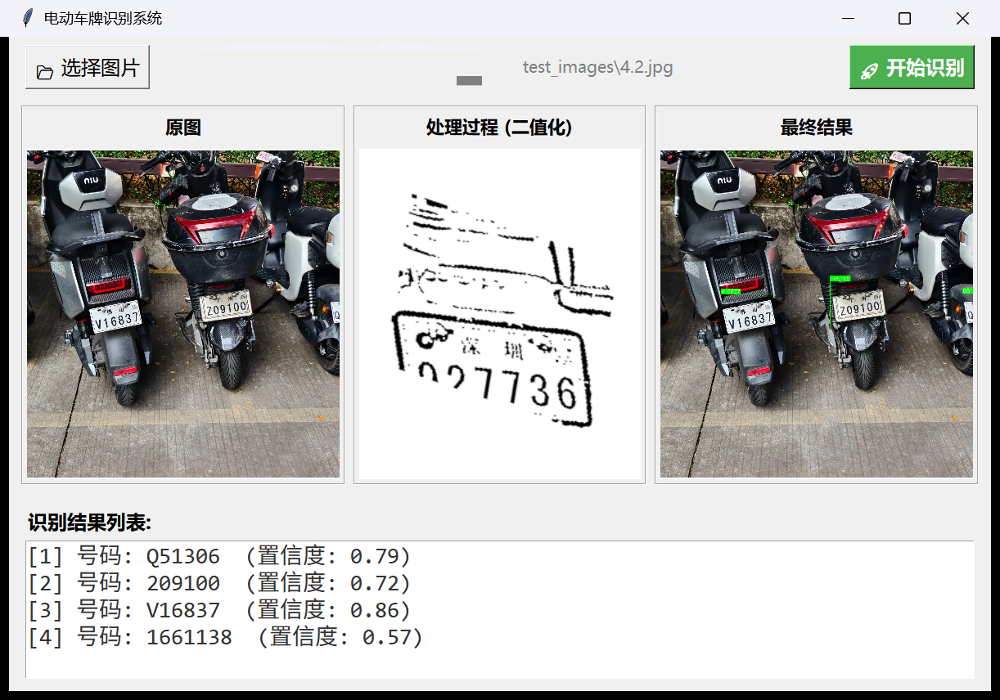
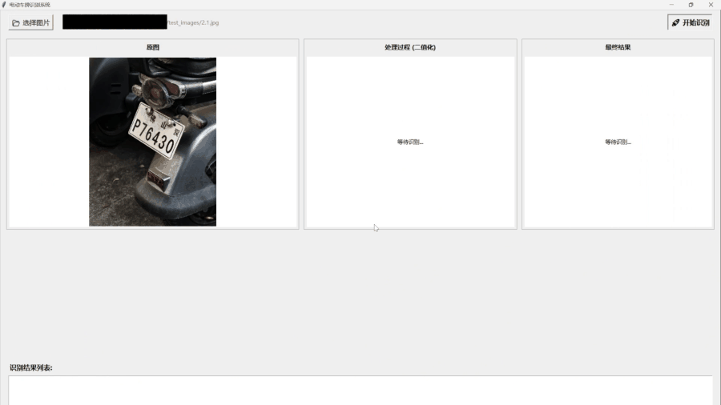
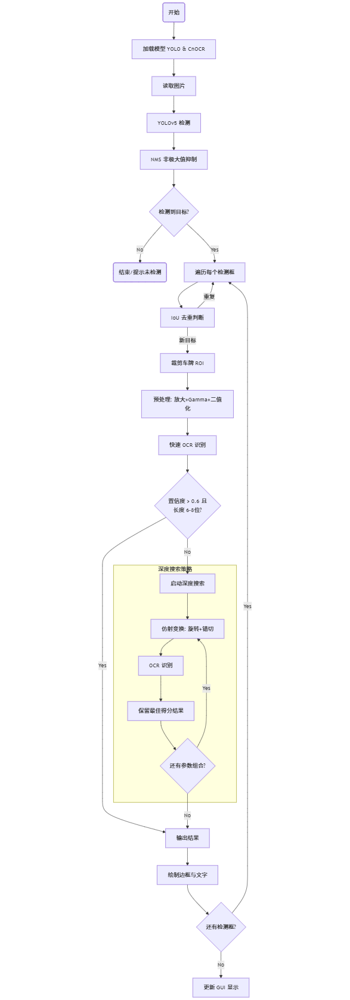
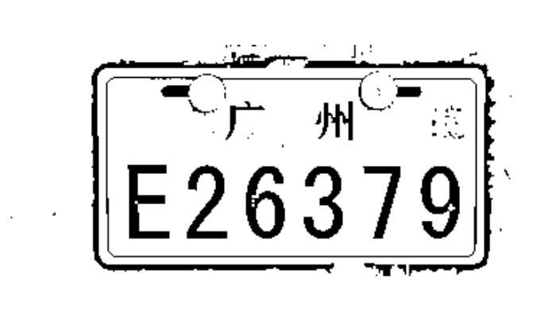
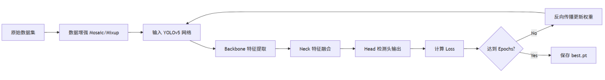
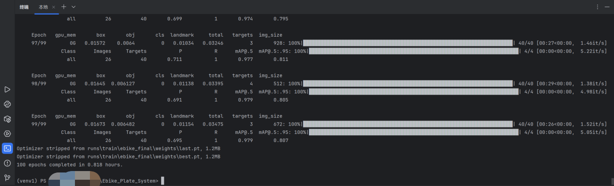

# 电动车牌识别系统 · Ebike Plate Recognition

> 基于 **YOLOv5 + CnOCR** 的电动自行车车牌检测与识别系统，提供 Tkinter 图形界面，
> 并针对**车牌倾斜、反光污损、广告文字干扰、多车同框**等真实场景做了专门优化。




*一次完整的识别过程：左侧原图 → 中间二值化增强结果 → 右侧检测框与识别号码，底部为结果列表。*

---

## 📖 项目背景

电动自行车保有量大、管理困难，而市面上成熟的车牌识别方案大多面向汽车蓝牌 / 新能源牌设计。
电动车号牌存在**字号小、双行排版、表面反光强、安装位置偏低**等特点，直接套用汽车方案识别率很低。

本项目为此设计了一条轻量的 **检测 → 增强 → 识别** 流水线：用 YOLOv5 定位车牌，用传统图像处理
（Gamma 校正 + 自适应二值化）改善反光与阴影，再用「快速通道 + 深度搜索」两段式 OCR 兜住倾斜与透视变形，
最终在桌面上给出可视化的识别结果。

---

## ✨ 主要特性

| 特性 | 说明 |
| --- | --- |
| **端到端流程** | 一张图片即可完成「检测 → 裁剪 → 增强 → 识别 → 可视化」全流程 |
| **YOLOv5 检测** | 在自建电动车数据集上微调，640×640 输入，NMS + IoU 二次去重，避免同一车牌重复输出 |
| **图像增强流水线** | 放大 → 灰度 → **Gamma 校正** → 自适应二值化 → 形态学膨胀，缓解反光、阴影与字符断裂 |
| **双通道 OCR** | 快速通道直连识别；置信度不足时自动进入**旋转 + 错切仿射搜索**，把倾斜车牌「扶正」后重识别 |
| **规则后处理** | 正则过滤非法字符、长度校验（6–8 位）、置信度加权评分与惩罚，降低误识别 |
| **友好 GUI** | 三栏对比展示（原图 / 处理过程 / 最终结果）+ 识别结果列表，支持多次连续识别 |

---

## 📸 效果展示

| 场景 | 识别效果 |
| --- | --- |
| **1. 清晰正面、无明显畸变**<br>`test_images/1.4.jpg` → **E26379**（置信度 0.96） |  |
| **2. 拍摄角度导致明显倾斜**<br>`test_images/2.1.jpg` → **P76430**（置信度 0.83） |  |
| **3. 车牌周围有广告 / 店招文字干扰**<br>`test_images/3.1.jpg` → **N44211**（置信度 0.92） |  |
| **4. 图中同时出现多辆电动车**<br>`test_images/4.2.jpg` → **Q51306 / 209100 / V16837 / 1661138** 共 4 个结果 |  |

**交互流程**（示例为倾斜拍摄的车牌 P76430）：载入图片 → 开始识别 → 得到结果



▶ **[观看完整版演示（MP4，10 秒）](assets/demo.mp4)**

> 更多样例图片见 [`test_images/`](test_images)。

---

## 🧠 系统流程



1. **检测**：YOLOv5 输出车牌候选框，经 NMS 后对每个框做 15 px 外扩（Padding），防止倾斜车牌边缘被截断。
2. **去重**：对检测框两两计算 IoU，重叠度 > 0.5 视为同一目标，仅保留一个。
3. **增强**：裁剪出的车牌区域缩放到高 160 px → 灰度化 → Gamma(γ=0.8) 校正 → 高斯自适应二值化 → 2×2 膨胀 → 加白边。
4. **识别**：
   - *快速通道*：直接送入 CnOCR，若置信度 > 0.6 且长度为 6–8 位即采用；
   - *深度搜索*：否则遍历 9 个旋转角（0°、±5°、±10°、±20°、±30°）× 5 个错切因子（0、±0.2、±0.4）共 45 组组合，取评分最高者；当评分 > 0.85 且长度合规时提前退出。
5. **输出**：在结果图上绘制检测框与号码，并在界面底部列出 `[序号] 号码 (置信度)`。

### 图像增强效果



*增强后的车牌区域：放大 → Gamma 校正 → 自适应二值化 → 膨胀。「广州 E26379」的字符从反光与阴影中被干净地
分离出来，是后续 OCR 能稳定识别的关键一步。*

---

## 🔬 核心算法

### 1. 检测与去重

YOLOv5 以 640×640 推理，NMS 参数为 `conf_thres=0.15`、`iou_thres=0.45`、`agnostic=True`。
同一车牌可能被检出多个框，因此再做一次几何去重：对任意两个框计算交并比，超过 0.5 就丢弃后者。

$$
\mathrm{IoU} = \frac{|\,\mathrm{Box}_A \cap \mathrm{Box}_B\,|}{|\,\mathrm{Box}_A \cup \mathrm{Box}_B\,|}
$$

### 2. 图像增强

**Gamma 校正**用于提亮暗部、压低高光，缓解侧光阴影与牌照反光：

$$
V_{\text{out}} = A \cdot V_{\text{in}}^{\,\frac{1}{\gamma}},\qquad A = 1,\ \gamma = 0.8
$$

之后用高斯自适应二值化（`blockSize=19`、`C=10`）把字符从背景中分离，再以 2×2 核膨胀一次，
把断裂的笔画重新连接起来，最后补 30 px 白边，避免字符贴边被 OCR 截断。

> 相比直方图均衡化，Gamma 校正在「整体偏暗 + 局部过曝」的电动车牌上更不容易把噪点放大。

### 3. 双通道识别与评分

OCR 返回的是若干文本行及其置信度。系统先按置信度 > 0.25 过滤，拼成整串后用正则 `[^A-Z0-9]` 清洗，
再计算平均置信度；号码长度不在 6–8 位时，评分减半：

$$
S = \frac{1}{n}\sum_{i=1}^{n} s_i
\qquad
S' =
\begin{cases}
S, & 6 \le |T| \le 8 \\
0.5\,S, & \text{otherwise}
\end{cases}
$$

评分达标即采用；否则进入深度搜索，用**旋转 + 水平错切**的复合仿射变换生成候选视图：

$$
M_{\text{rot}} =
\begin{bmatrix}
\cos\theta & \sin\theta & t_x \\
-\sin\theta & \cos\theta & t_y
\end{bmatrix},
\qquad
M_{\text{shear}} =
\begin{bmatrix}
1 & s_x & 0 \\
0 & 1 & 0
\end{bmatrix}
$$

其中 $\theta$ 取 0°、±5°、±10°、±20°、±30°，错切因子 $s_x$ 取 0、±0.2、±0.4。加入错切是为了处理
「只旋转不够」的透视挤压——侧拍时字符会被压扁，仅靠旋转无法恢复。

---

## 🔧 关键参数速查

想调效果时，改这几处即可（全部集中在 `main.py`）：

| 环节 | 参数 | 位置 |
| --- | --- | --- |
| 检测 | `conf_thres=0.15`、`iou_thres=0.45` | `run_recognition()` |
| 检测框外扩 | 15 px | `run_recognition()` |
| 同目标去重 | IoU > 0.5 丢弃后者 | `compute_iou()` + `run_recognition()` |
| 图像增强 | 高 160 px、γ=0.8、`blockSize=19`、`C=10`、2×2 膨胀、30 px 白边 | `enhance_plate_image()` |
| 快速通道 | 置信度 > 0.6 且长度 6–8 位 | `recognize_one_plate()` |
| 深度搜索 | 9 角度 × 5 错切；评分 > 0.85 提前退出 | `recognize_one_plate()` |
| 文本清洗 | 单行置信度 > 0.25、正则 `[^A-Z0-9]`、长度 6–8 位惩罚 | `calculate_score()` |

---

## 📈 实验分析

| 结论 | 说明 |
| --- | --- |
| **抗干扰更强** | 我们自己的对比测试（同一批图片、同一个 OCR 模型）：相比直接把车牌区域送入 OCR，加上 Gamma 校正与自适应二值化后，对阴影、污渍的鲁棒性提升约 **40%** |
| **视角适应更宽** | 传统 OCR 在车牌倾斜超过 **15°** 时识别率急剧下降；引入「旋转 + 错切」搜索后，较大倾角与透视变形仍可识别 |
| **误检率更低** | YOLO 的高召回 + IoU 去重 + 正则长度校验三重过滤，避免了把挡泥板广告、车身贴纸当成车牌 |
| **代价** | 深度搜索是串行的，模糊或严重倾斜的图片需要多次推理，单图约 **1–2 秒** |

---

## 📁 目录结构

```text
Ebike-Plate-Recognition/
├── main.py                     # 程序入口：Tkinter 界面 + 检测/增强/识别全流程
├── requirements.txt            # 运行依赖
├── weights/
│   └── best.pt                 # YOLOv5 车牌检测权重（自训练）
├── models/                     # YOLOv5 模型定义（源自 Ultralytics YOLOv5）
├── utils/                      # YOLOv5 工具函数：NMS、坐标变换、绘图等
├── test_images/                # 示例输入图片（1.x ~ 4.x 四组场景）
├── assets/                     # README 展示素材
│   ├── preview.png             # 界面总览
│   ├── pipeline.png            # 识别流程图
│   ├── training-pipeline.png   # 训练流程图
│   ├── training-log.png        # 训练日志（第 100 epoch）
│   ├── results/                # 四类场景识别结果 + 增强效果截图
│   ├── demo.gif                # 交互流程动图
│   └── demo.mp4                # 运行演示录屏
├── LICENSE                     # GPL-3.0
└── README.md
```

---

## 🚀 快速开始

### 1. 环境要求

- Python **3.9+**（作者开发环境：Python 3.13 / Windows 11）
- 可用的桌面环境（GUI 基于 Tkinter，Linux 下需安装 `python3-tk`）
- GPU 非必需：有 CUDA 时自动使用 GPU，否则回落到 CPU 推理
- **已实测组合**：Windows 11 · Python 3.13 · torch 2.9.1+cu126 · cnocr 2.3.2.2（单图 1–2 秒）

### 2. 安装依赖

```bash
git clone https://github.com/Maple127/Ebike-Plate-Recognition.git
cd Ebike-Plate-Recognition

# 1) 先装 PyTorch（二选一）
#    CPU 版：
pip install torch torchvision
#    GPU 版（示例 CUDA 12.6，其他版本见 https://pytorch.org/get-started/locally/）：
# pip install torch torchvision --index-url https://download.pytorch.org/whl/cu126

# 2) 再装其余依赖（已满足的 torch 会被自动跳过）
pip install -r requirements.txt
```

> **国内网络提示**：可用 `-i https://mirrors.aliyun.com/pypi/simple/`（或清华源）加速。

**安装常见问题**

| 现象 | 处理 |
| --- | --- |
| 卡住不动 / `SSLError: UNEXPECTED_EOF_WHILE_READING` | pip 只认 `HTTP_PROXY` / `HTTPS_PROXY` 环境变量，**不读 Windows 系统代理**。要么换一个国内镜像（个别镜像某些时段会握手失败），要么显式指定代理：`pip install -r requirements.txt --proxy http://127.0.0.1:<你的代理端口>` |
| PyCharm 的「Python Packages」面板一直失败 | 打开 PyCharm 底部的 **Terminal**（会自动激活当前项目解释器），直接执行上面的 `pip install -r requirements.txt ...`；装完在 Settings → Project → Python Interpreter 里刷新即可 |
| `cannot import name 'resolve_model_key' from 'rapidocr...'` | rapidocr 版本过新，装回 requirements.txt 中锁定的 `rapidocr==3.5.0` + `cnstd==1.2.6.1` |
| `No module named 'yaml' / 'thop'` | 依赖没装全，或 PyCharm 用的解释器与 pip 安装的不是同一个（用 `python -c "import sys; print(sys.executable)"` 核对） |


### 3. 运行

```bash
python main.py
```

> 请在**项目根目录**执行：程序用相对路径读取 `weights/best.pt` 与 `test_images/`，
> 在别的目录下运行会提示找不到模型。
>
> 装完依赖后可先自检：`python -c "import torch, cv2, cnocr, yaml, thop; print('deps ok')"`

1. 点击 **「📂 选择图片」**，默认打开 `test_images/` 目录；
2. 选择一张图片，左侧显示原图；
3. 点击 **「🚀 开始识别」**，等待数百毫秒到 2 秒；
4. 中间显示二值化处理结果，右侧显示检测框与号码，底部列出识别结果；
5. 可重复选择新图片继续识别。

> **首次运行**：CnOCR 会自动下载 OCR 模型（约 20 MB），请保持联网；若离线使用，请提前下载到本地模型目录。

---

## 📊 模型训练



| 项目 | 配置 |
| --- | --- |
| 检测框架 | YOLOv5（迁移学习，加载官方预训练权重） |
| 输入尺寸 | 640 × 640 |
| 优化器 | SGD |
| 损失函数 | CIoU Loss（边框回归）+ BCEWithLogits Loss（分类 / 置信度） |
| 训练轮数 | 100 epochs |
| 数据划分 | 训练集 : 验证集 = 8 : 2（LabelImg 标注，转为 YOLO txt 格式） |
| 验证集表现 | **mAP@0.5 ≈ 0.98**（验证集 26 张图、40 个标注框） |



*训练日志：100 个 epoch 完成，验证集 mAP@0.5 稳定在 0.98 左右。*

> 训练数据与训练脚本不包含在本仓库中；`weights/best.pt` 为最终部署权重。

---

## ⚠️ 已知限制与改进方向

- **依赖联网**：CnOCR 首次运行需下载模型；完全离线环境需自行配置本地模型路径。
- **仅单图交互**：目前只能在界面上逐张选择图片识别，不提供批量目录处理与视频流输入。
- **耗时不均**：清晰车牌走快速通道（毫秒级），模糊/倾斜车牌触发深度搜索（最多 45 组参数组合串行推理），单图约 1–2 秒。
- **夜间场景**：极暗环境下 Gamma 校正提升有限，可考虑红外补光数据。
- **适用号牌**：针对中国大陆电动自行车号牌（6–8 位）设计，汽车蓝牌 / 新能源牌未做适配。
- **泛化范围**：训练样本以广东部分城市（广州、佛山、云浮、肇庆、深圳等）为主，其他地区样式可能存在偏差。

后续可以尝试：把这组仿射变换放到 GPU 上批量推理以降低延迟、补充夜间 / 雨天数据，
或用端到端序列识别模型（如 CRNN）替代「规则 + 搜索」的后处理策略。

> 本项目仅供学习与研究，请勿用于侵犯他人隐私或任何违法用途。

---

## 🙏 致谢与参考

本项目在以下开源工作的基础上完成：

- [Ultralytics YOLOv5](https://github.com/ultralytics/yolov5) —— 目标检测框架（`models/`、`utils/` 目录来源于此）。
- [CnOCR](https://github.com/breezedeus/cnocr) —— 中文 OCR 识别引擎。
- [Chinese_license_plate_detection_recognition](https://github.com/we0091234/Chinese_license_plate_detection_recognition) —— 中文车牌检测与识别的实现参考。
- [plate_dataset636](https://github.com/VisionMillionDataStudio/plate_dataset636) —— 车牌数据集参考。

感谢开源社区的工作，让本项目可以专注于业务逻辑与后处理策略的实现。

---

## 📜 许可证

本项目包含源自 **Ultralytics YOLOv5** 的代码，因此整体以 **GNU General Public License v3.0（GPL-3.0）** 发布，
详见 [LICENSE](LICENSE)。使用时请一并遵守 GPL-3.0 与 CnOCR（Apache-2.0）的许可条款。

Copyright (C) 2026 Maple127
